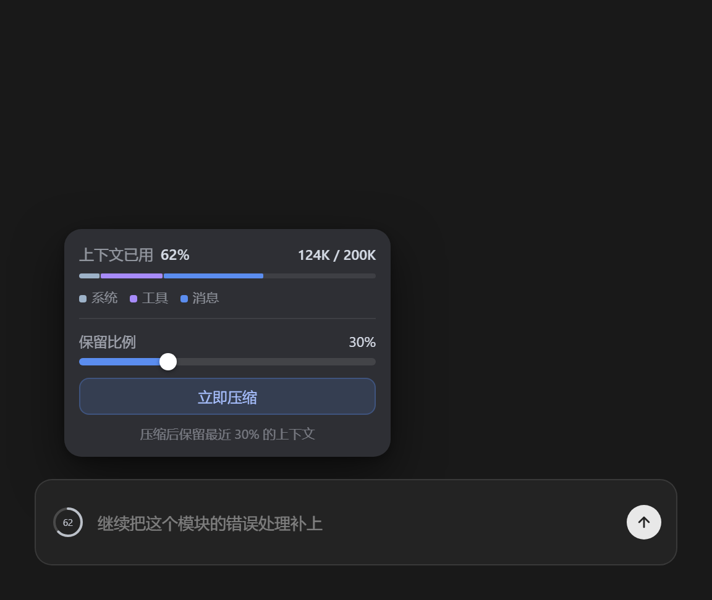

# dsh-compaction-control

[English](README.en.md) | 中文

dsh（DeepSeek Harness）输入栏的**上下文压缩控制中心**：在模型选择器左边放一颗上下文占用圆环，点开即可**一键手动压缩**、**调节自动压缩阈值**，并可选**隐藏右下角内置圆环**。



## 为什么需要它

dsh 内置的自动压缩（`compaction-basic`）只在 token 压力达到窗口 80% 时于回合边界触发，参数固定在 profile 组合里；手动压缩只有 `/compact` 斜杠命令一个入口。本插件把两者都变成输入栏上的可视化操作：

- **圆环**：与内置 ContextMeter 同款几何（14px 环 + 百分比），数据走官方 `contextPressure` / `contextBreakdown` 会话投影。
- **立即压缩**：调用官方 `ctx.compaction.compactNow(agent, signal)`，等价 `/compact` 命令，免打字。仅空闲会话可用，正忙/失败原因会在面板里用中文提示。
- **自动压缩调节**：启用开关 + 触发阈值（50%~95%）+ 保留比例（4%~40%）。保存后写入每个挂载本插件的 profile 的**用户补丁层**（`~/.dsh/profiles/<name>/cordis.patch.yml`，id 定向覆盖 `compaction-basic` 的 config），**重启 dsh 后生效**。
- **隐藏内置圆环**：内置圆环硬编码在输入卡下方的 dock 条里（不在槽位中、无官方开关）。开启后本插件在运行时将其 `display:none`，界面只保留模型选择器旁边这一颗。

## 安装

```sh
dsh plugin --profile web add D:\AIiteams\dsh插件\packages\dsh-compaction-control
dsh plugin --profile desktop add D:\AIiteams\dsh插件\packages\dsh-compaction-control
```

装完重启 dsh。

## 使用

1. 输入栏右侧、模型选择器左边出现绿色占用圆环（75% 起变黄、90% 起变红）。
2. 点击圆环打开面板：
   - 顶部为占用百分比与 ~已用/窗口、三段构成条（系统提示 / 工具定义 / 对话历史）；
   - 「立即压缩当前会话」执行一次手动压缩，结果显示压缩了多少条、约多少 tokens；
   - 「自动压缩」区调节参数后点「保存设置」，面板会提示写入了哪些 profile。
3. 右下角内置圆环默认被隐藏；想两颗并存，在面板里把「内置圆环」切回显示并保存。

## 工作原理

```
客户端（conversation.input.right 槽位）        服务端（/api/dsh-compaction-control）
  useProjection('contextPressure')   ←官方投影─ token-meter 注册
  useProjection('contextBreakdown')
  「立即压缩」 ──POST /compact {sessionId}──→ ctx.agents.get(sessionId)
                                             ctx.compaction.compactNow(agent, signal)
  「保存设置」 ──POST /state {auto,          ~/.dsh/compaction-control.json（事实源）
                thresholdRatio, retainRatio,  → ~/.dsh/profiles/*/cordis.patch.yml
                hideBuiltIn}                     （id: compaction-basic 的 config 覆盖）
```

- 补丁层是 dsh 官方 `initProfile` 创建的用户文件，插件管理器不会回收它；但 loader 只在启动时读取，所以参数保存后需要重启。
- 写入采用 `# BEGIN/END dsh-compaction-control` 标记的纯文本手术，用户自己在该文件里的其他条目原样保留；服务端检测到 `yaml` 库时会先校验语法再落盘。
- 状态文件 `~/.dsh/compaction-control.json` 是唯一事实源，补丁文件可随时由它重新生成。

## 已知边界

- 手动压缩要求会话空闲；agent 运行中或已有压缩任务时会提示「会话正忙」。
- 阈值/保留比例的约束沿用 compaction-basic：保留比例必须小于触发阈值（面板内即时校验，服务端二次校验）。
- profile 的 `cordis.patch.yml` 若被手工改成非数组结构，写入会因语法校验失败而中止并提示，不会破坏原文件。
- 内置圆环的隐藏靠 DOM 特征识别（dock 条内带双 circle svg 的 dialog 按钮）；dsh 未来改版若换结构，隐藏会静默失效（圆环只是回到两颗并存，功能不受损）。
- 卸载本插件后记得检查 profile 补丁层里的受管块是否残留（可直接删掉 BEGIN/END 之间及标记本身，或整块留着也无害——compaction-basic 会按其中的参数运行）。

## 排障

看 `~/.dsh/compaction-control-debug.log`（boot/register/state-error/compact 各阶段一行 JSON）。区分「服务端没起」还是「客户端崩了」的方法与 power-picker 相同：文件里只有 `server boot` 说明客户端模块没加载。DevTools 里 `window.__dshCompactionControl` 可查版本。

## 许可

MIT
